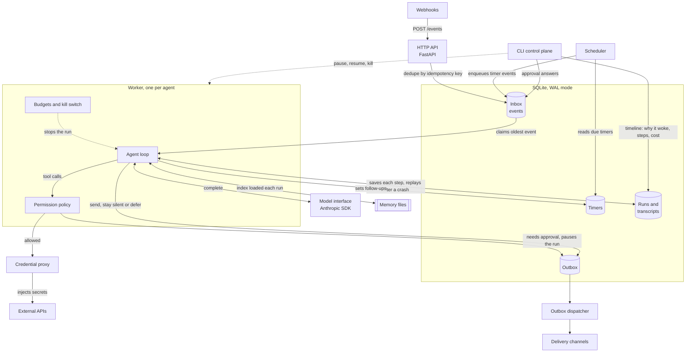

# double-agent

An open source runtime for always-on agents: AI agents that stay alive between events. It wakes the agent on webhooks and timers, survives crashes, waits for humans to approve risky actions, and keeps the agent within a budget.

## Why

An agent that runs once and exits is easy. An always-on agent that runs for weeks is not: it has to remember what it was doing, wake itself up later, keep going after a crash without repeating actions, and stop before it spends too much or does something it shouldn't.

double-agent builds always-on agents from five parts: an inbox, timers, memory, permissions and an outbox. It adds budgets and a run timeline on top.

## What it will do

- **Inbox:** events from webhooks and timers land in a per-agent inbox. Duplicate deliveries are ignored, and one worker per agent processes events one run at a time.
- **Crash recovery:** the session transcript is saved after every step. Kill the process mid-run, restart it, and the run resumes without repeating a completed action.
- **Timers:** agents can set their own follow-ups and recurring schedules. A sleeping agent uses no resources until it is due.
- **Outbox:** each run ends by sending a message, staying silent, or deferring. The agent's final text is never sent automatically.
- **Approvals:** tools that need a human's approval pause the run. The request survives restarts, and answering it resumes the run.
- **Credential proxy:** secrets are injected into outgoing calls on the agent's behalf. The agent never sees a raw credential.
- **Budgets and kill switch:** per-agent caps on tokens, cost and action rate, plus a switch that halts an agent immediately.
- **Memory:** file-based memory with an index loaded on every run, and per-task progress notes.
- **Run timeline:** a CLI view that shows why each run woke, what it did and what it cost.

Out of scope: distributed workers, multi-tenancy, a web dashboard and step-level replay.

## Architecture

Everything runs in one process on one machine, with all state in a single SQLite file. Events reach the inbox from webhooks, timers and approval answers. Each agent has one worker that claims the oldest event and drives the agent loop, saving every step so a crashed run can resume where it left off. Tool calls pass through the permission policy and the credential proxy, and anything the agent wants to say goes through the outbox.

## Tech stack

Python 3.12+ and asyncio, SQLite (WAL mode) via `aiosqlite`, FastAPI and `uvicorn` for incoming webhooks, `httpx` for the credential proxy, Pydantic v2, a Typer CLI, and the Anthropic SDK behind a small model interface. Tooling is `uv`, `ruff`, `pyright` and `pytest`.

## Roadmap

Each phase ends with a check that shows it works.

- [x] **0. Spec and skeleton:** glossary; interfaces for storage, model calls and the outbox; a decision on events that arrive mid-run; repo skeleton and CI.
  - *Done when:* CI runs ruff, pyright and pytest and passes; each interface has an in-memory fake that a test exercises; the glossary and the mid-run decision are written down.
- [x] **1. Core loop:** event inbox with dedupe and status tracking; one worker per agent claiming events; run lifecycle (start, resume, finish); session transcript saved after each step; crash-recovery test.
  - *Done when:* delivering the same webhook twice creates one event and one run; two events for one agent never run at the same time; a SIGKILL mid-run is followed by a restart that resumes from the last saved step without repeating a completed one.
- [x] **2. Timers and scheduler:** timer store; self-set follow-ups and recurring schedules; a scheduler that enqueues due timers idempotently; waking from sleep with no process held open.
  - *Done when:* a one-off timer fires once at its due time, even if the process restarts before then; a recurring schedule enqueues one event per tick even if the scheduler restarts or runs twice; between fires the agent has no open run or worker task.
- [ ] **3. Outbox and approvals:** outbox with three run outcomes (send, stay silent, defer); dispatcher with first adapters; deferred tool calls that pause a run and resume on the answer; approvals through the CLI.
  - *Done when:* tests with a fake adapter show send delivers once, stay silent delivers nothing and defer delivers later; a crash during dispatch does not send twice; an approval requested before a restart is still pending afterwards, approving it resumes the run, and denying it returns a denial to the agent.
- [ ] **4. Safety and budgets:** credential proxy; per-agent budgets for tokens, cost and action rate; kill switch; policy rules for which tools need approval.
  - *Done when:* a proxied call succeeds with the injected credential while the secret never appears in prompts, transcripts or logs; a looping test agent stops at its token, cost and action-rate caps; the kill switch halts a running agent before its next step; a tool marked as needing approval cannot run without one.
- [ ] **5. Memory:** file-based memory with an index loaded each run; pointers to external systems instead of copies; per-task progress notes.
  - *Done when:* a fact written to memory in one run appears in the index loaded by the next run, even after a restart; progress notes let a multi-run task continue where it left off; memory holds pointers to external systems, not copies of their data.
- [ ] **6. Control plane:** run log recording why each run woke, its steps and its cost; a CLI timeline view; CLI commands to pause, resume, kill and inspect agents.
  - *Done when:* for a scripted run, the CLI timeline shows the wake reason, every step and a cost that matches recorded usage; pause stops new runs, resume restarts them, kill stops a run mid-way, and inspect shows the agent's current state.
- [ ] **7. Examples and launch:** a repo steward example agent plus one more; README built around the crash-recovery demo; quick start and docs; launch post.
  - *Done when:* on a fresh machine, following only the quick start gets both example agents running in under ten minutes (timed); the crash-recovery demo in the README is recorded from a real run.

## Licence

MIT. See [LICENSE](LICENSE).
