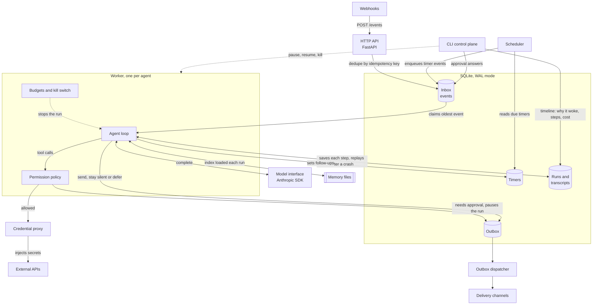

# double-agent

An open source runtime for always-on agents: AI agents that stay alive between events. It wakes the agent on webhooks and timers, survives crashes, waits for humans to approve risky actions, and keeps the agent within a budget.

## Why

An agent that runs once and exits is easy. An always-on agent that runs for weeks is not: it has to remember what it was doing, wake itself up later, keep going after a crash without repeating actions, and stop before it spends too much or does something it shouldn't.

double-agent builds always-on agents from five parts: an inbox, timers, memory, permissions and an outbox. It adds budgets and a run timeline on top.

## What it will do

- **Inbox:** events from webhooks and timers land in a per-agent inbox. Duplicate deliveries are ignored, and one worker per agent processes events one run at a time.
- **Crash recovery:** the session transcript is saved after every step. Kill the process mid-run, restart it, and the run resumes without repeating a completed action.
- **Timers:** agents can set their own follow-ups and recurring schedules. A sleeping agent uses no resources until it is due.
- **Outbox:** each run ends by sending a message, staying silent, or deferring. The agent's final text is never sent automatically.
- **Approvals:** tools that need a human's approval pause the run. The request survives restarts, and answering it resumes the run.
- **Credential proxy:** secrets are injected into outgoing calls on the agent's behalf. The agent never sees a raw credential.
- **Budgets and kill switch:** per-agent caps on tokens, cost and action rate, plus a switch that halts an agent immediately.
- **Memory:** file-based memory with an index loaded on every run, and per-task progress notes.
- **Run timeline:** a CLI view that shows why each run woke, what it did and what it cost.

Out of scope: distributed workers, multi-tenancy, a web dashboard and step-level replay.

## Architecture

Everything runs in one process on one machine, with all state in a single SQLite file. Events reach the inbox from webhooks, timers and approval answers. Each agent has one worker that claims the oldest event and drives the agent loop, saving every step so a crashed run can resume where it left off. Tool calls pass through the permission policy and the credential proxy, and anything the agent wants to say goes through the outbox.

## Tech stack

Python 3.12+ and asyncio, SQLite (WAL mode) via `aiosqlite`, FastAPI and `uvicorn` for incoming webhooks, `httpx` for the credential proxy, Pydantic v2, a Typer CLI, and the Anthropic SDK behind a small model interface. Tooling is `uv`, `ruff`, `pyright` and `pytest`.

## Roadmap

1. Spec and skeleton
2. Core loop and crash recovery
3. Timers and scheduler
4. Outbox and approvals
5. Safety and budgets
6. Memory
7. CLI control plane and timeline
8. Example always-on agents and launch

## Licence

MIT. See [LICENSE](LICENSE).
